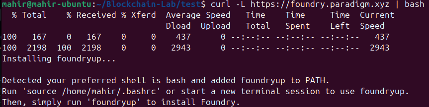
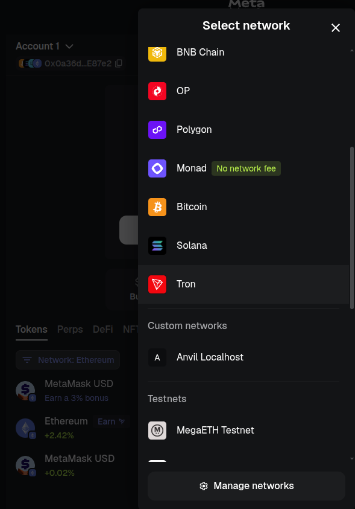
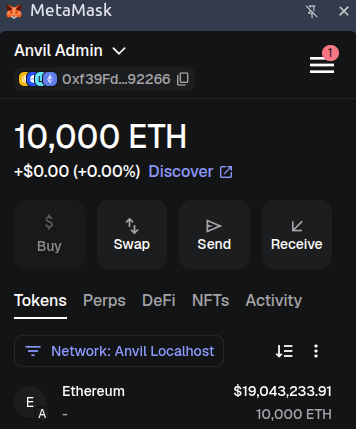
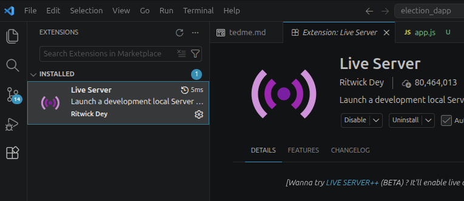
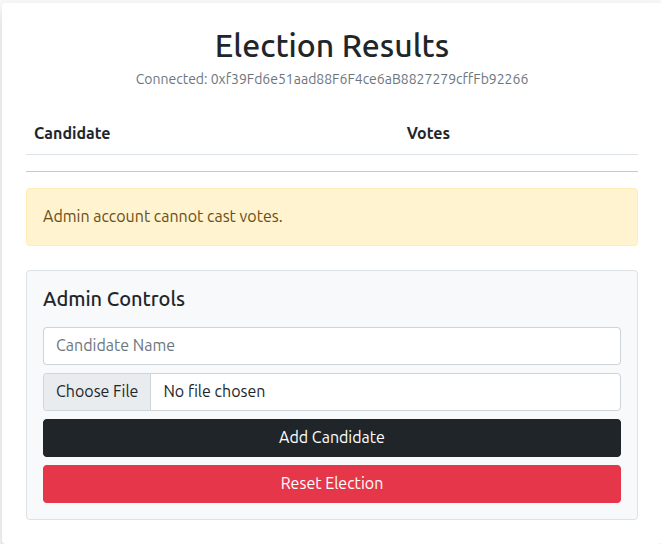
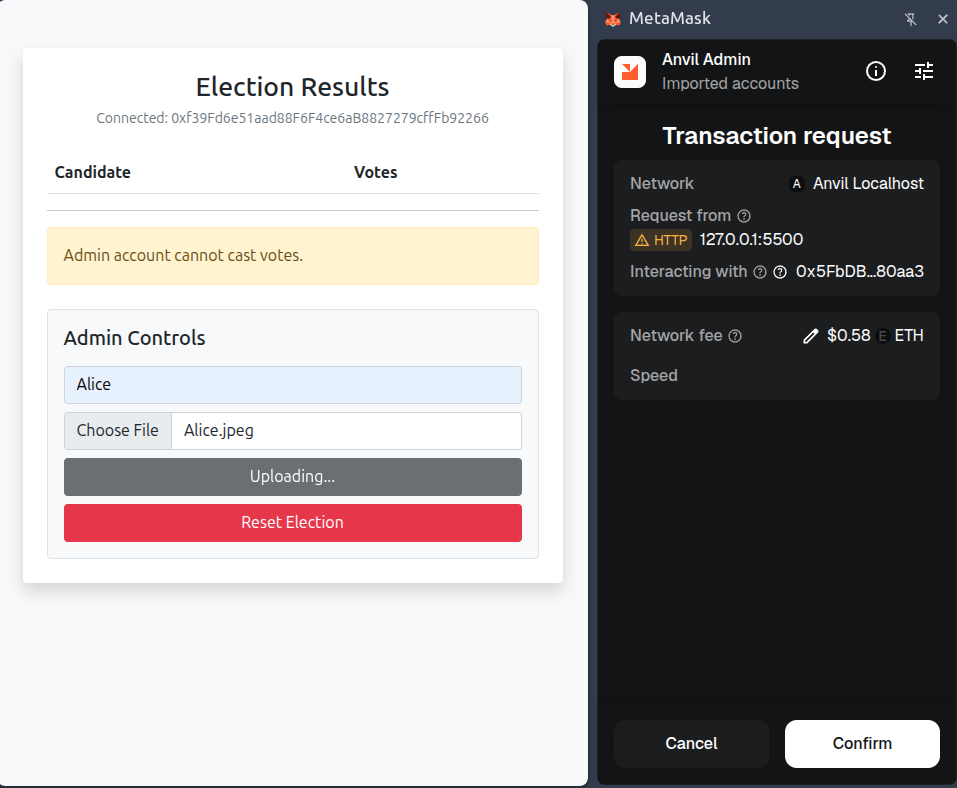
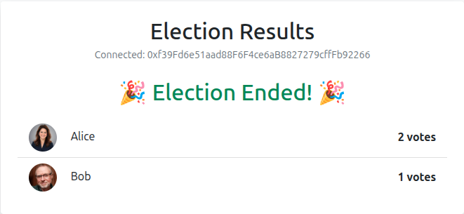

# Lab 5: Building a Web3 Voting DApp with Ethereum, Foundry, and IPFS

## Objectives:
- To create a modern Ethereum decentralized web application using Foundry (Anvil & Forge) and Ethers.js.
- To decentralize heavy file storage (images) utilizing the IPFS network via Pinata.
- To utilize MetaMask to offload account management and securely sign transactions.
- To understand the difference between manual state fetching and blockchain event-driven auto-syncing.

## Submission: 
- Five checkpoints.

## Description:
In this lab, you will learn how to deploy a smart contract using the modern development environment Foundry. You will use Anvil, an in-memory local blockchain node, and Forge, a fast compiler and deployment tool. Unlike previous labs where all data was stored on-chain, you will integrate Pinata to store Candidate images on the InterPlanetary File System (IPFS) to save massive amounts of gas fees. Finally, you will build a Vanilla JavaScript frontend to interact with this architecture.

---

# Section-1: Development Environment Setup
The first step is to set up our modern Web3 tools and local blockchain.

1. Run these commands in your terminal to set up and check the lab version of Node.js.

   ```shell
   nvm install 22.23
   nvm alias default 22.23
   node -v
   ```

   You should see `v22.23.x` confirming the installation.

2. To install Foundry, run this command in your terminal.

   ```shell
   curl -L https://foundry.paradigm.xyz | bash
   ```

   

   Close and reopen your terminal and run the following command.

   ```shell
   foundryup
   ```

   

3. Start your local blockchain node in the terminal.

   ```shell
   anvil
   ```

   

   Leave this terminal running for the entire lab. Anvil lists 10 accounts and their private keys. Each account starts with 10,000 local test ETH.

### Now we will run our MetaMask wallet, add our local network to it and import some wallets from the local chain.

1. If MetaMask is already available on your browser, skip this step. Else, go to https://metamask.io/ and install the extension.
2. We need to connect MetaMask to our running Anvil node. Open MetaMask, click the three dots or, sandwich icon and click the Networks option here.


3. From here click the bottom `Add a custom network option` and add our Custom network details like the bottom Screenshot with the following information:


- Network Name: ```Anvil Localhost```

- New RPC URL: ```http://127.0.0.1:8545```

- Chain ID: ```31337```

- Currency Symbol: ```ETH```

Note: Do not pay heed to the yellow warnings and save it.

4. Our Local Anvil network won't be chosen by default so, click the Network: Option that is seen below the Tokens option and choose our Custom Network which should be ```Anvil Localhost```

.

5. Go to your Anvil terminal, copy the Private Key for ```Account (0)```. In MetaMask, click your Account option (above) -> Add wallet (below) -> Import Account (Via a private key) -> paste the private key. You should now see an account with 10,000 ETH!



Rename this account **Anvil Admin** so it is easy to identify. In Section 2, you deploy the contract with Anvil Account 0. The constructor saves the deployer's address, `msg.sender`, as the contract admin.

### We need a decentralized storage anchor now. 

Go to [Pinata.cloud ](https://pinata.cloud/)and create a free account. 


It is easier to just click sign in with google since we will just be using it's API functionalities.

Navigate to API Keys (Left Below Developer) -> +New Key (Top Right). Give it a name and for now Grant Admin permissions, generate the key, and copy the JWT (JSON Web Token). Save this somewhere safe.


# Checkpoint – 1: 
Show your teacher your Anvil terminal running, your MetaMask connected to the ```31337``` network with ```10,000 ETH```, and your Pinata ```JWT``` copied.

# Section-2: Smart Contract Development
Now we will write and deploy our backend logic using Forge.

### Create the Foundry project

Keep Anvil running. In a second terminal, run these commands from the folder where you keep your lab projects. The last command initializes Foundry inside `election_dapp`.

```shell
mkdir election_dapp
cd election_dapp
forge init
```


### Create and fill `src/Voting.sol`

From the `election_dapp` terminal, run this command to create the file. Keep the example `src/Counter.sol` file because the generated test and script import it.

```shell
touch src/Voting.sol
```
**Paste the entire Solidity block below into `src/Voting.sol` and save the file.** Leave the `TODO_SC` comments for Section 5.

```solidity
// SPDX-License-Identifier: MIT
pragma solidity ^0.8.20;

contract Voting {
    struct Candidate {
        uint256 id;
        string name;
        uint256 voteCount;
        string ipfsImageHash;
    }

    mapping(uint256 => Candidate) public candidates;
    mapping(address => uint256) public hasVoted; 

    uint256 public candidatesCount;
    uint256 public totalVotes; 
    uint256 public electionId; 
    address public admin;

    uint256 public constant MAX_VOTES = 3; 

    // TODO_SC-1: YOU WILL DECLARE BLOCKCHAIN EVENTS HERE LATER

    error AlreadyVoted();
    error InvalidCandidate();
    error ElectionEnded(); 
    error AdminCannotVote();

    constructor() {
        admin = msg.sender;
        electionId = 1; 
    }

    function addCandidate(string calldata _name, string calldata _ipfsImageHash) public {
        require(msg.sender == admin, "Only admin can add candidates");
        candidatesCount++;
        candidates[candidatesCount] = Candidate(candidatesCount, _name, 0, _ipfsImageHash);
        
        // TODO_SC-2: YOU WILL EMIT AN EVENT HERE LATER
    }

    function vote(uint256 _candidateId) public {
        if (msg.sender == admin) revert AdminCannotVote();
        if (totalVotes >= MAX_VOTES) revert ElectionEnded();
        if (hasVoted[msg.sender] == electionId) revert AlreadyVoted();
        if (_candidateId == 0 || _candidateId > candidatesCount) revert InvalidCandidate();

        hasVoted[msg.sender] = electionId; 
        candidates[_candidateId].voteCount++;
        totalVotes++; 

        // TODO_SC-3: YOU WILL EMIT AN EVENT HERE LATER
    }
    
    // TODO_SC-4: YOU WILL ADD THE RESET ELECTION FUNCTION HERE LATER
}
```
### Deploy the contract

From the `election_dapp` terminal, run the command below. It uses the default Anvil Account 0 key, so the deployed contract will recognize that account as admin.

```shell
forge create src/Voting.sol:Voting --rpc-url http://127.0.0.1:8545 --private-key 0xac0974bec39a17e36ba4a6b4d238ff944bacb478cbed5efcae784d7bf4f2ff80 --broadcast
```
CRITICAL: In the terminal output, find ```Deployed to: 0x...``` and copy that address. You will need it for your frontend and it could update after every change and consequent forge create.

# Checkpoint – 2: 
Show your teacher the successful deployment output and the ```Deployed to``` address.

# Section-3: DApp Skeleton & IPFS Setup
We will now build the frontend to interact with our contract and Pinata.

### Create the frontend files

Run these commands from the `election_dapp` terminal to create the three files used in this section.

```shell
mkdir frontend
cd frontend
touch index.html ipfsHelper.js app.js
```
### Fill `frontend/index.html`

**Paste the entire HTML block below into `frontend/index.html` and save the file.**

```html
<!DOCTYPE html>
<html lang="en">
<head>
    <meta charset="UTF-8">
    <meta name="viewport" content="width=device-width, initial-scale=1.0">
    <title>Web3 Voting DApp</title>
    <!-- Corrected Bootstrap URL -->
    <link href="https://cdn.jsdelivr.net/npm/bootstrap@5.1.3/dist/css/bootstrap.min.css" rel="stylesheet">
</head>
<body class="bg-light">

<div class="container mt-5">
    <div class="row justify-content-center">
        <div class="col-md-6 bg-white p-4 rounded shadow">
            
            <h2 class="text-center mb-1">Election Results</h2>
            <p id="accountAddress" class="text-center text-muted small mb-4">Connecting...</p>

            <!-- Winner View -->
            <div id="winnerBanner" style="display:none;" class="text-center">
                <h2 class="text-success mb-3">🎉 Election Ended! 🎉</h2>
                <ul id="winnerStats" class="list-group list-group-flush mt-3"></ul>
            </div>

            <!-- Voting View -->
            <div id="votingArea">
                <table class="table table-hover">
                    <thead><tr><th>Candidate</th><th>Votes</th></tr></thead>
                    <tbody id="candidatesResults"></tbody>
                </table>
                <hr>
                <form id="votingForm" onsubmit="event.preventDefault(); App.castVote();">
                    <select class="form-select mb-2" id="candidatesSelect"></select>
                    <button id="voteBtn" class="btn btn-primary w-100">Cast Vote</button>
                </form>
                <p id="alreadyVotedMsg" class="alert alert-warning mt-2" style="display:none;"></p>
            </div>

            <!-- Admin Area -->
            <div id="adminArea" class="mt-4 p-3 border rounded bg-light" style="display:none;">
                <h5 class="mb-3">Admin Controls</h5>
                <input id="candidateName" class="form-control mb-2" placeholder="Candidate Name">
                <input type="file" id="candidateImage" class="form-control mb-2">
                <button onclick="App.addCandidate()" id="addBtn" class="btn btn-dark w-100">Add Candidate</button>
            </div>
        </div>
    </div>
</div>

<!-- JS URLs -->
<script src="https://code.jquery.com/jquery-3.6.0.min.js"></script>
<script src="https://cdnjs.cloudflare.com/ajax/libs/ethers/6.7.0/ethers.umd.min.js"></script>
<script src="ipfsHelper.js"></script>
<script src="app.js"></script>
</body>
</html>
```
### Fill `frontend/ipfsHelper.js`

**Paste the entire JavaScript block below into `frontend/ipfsHelper.js`.** At `TODO_JS-1`, replace only `YOUR_JWT_TOKEN_HERE` with your Pinata JWT, keeping the quotation marks. Save the file. This helper sends the image to Pinata and returns the CID for the contract to store.

```javascript
// ipfsHelper.js
window.uploadToIPFS = async (file) =>{
    // TODO_JS-1: PASTE YOUR PINATA JWT HERE
    const PINATA_JWT = "YOUR_JWT_TOKEN_HERE"; 

    const formData = new FormData();
    formData.append("file", file);

    try {
        const response = await fetch("https://api.pinata.cloud/pinning/pinFileToIPFS", {
            method: "POST",
            headers: { Authorization: `Bearer ${PINATA_JWT}` },
            body: formData,
        });
        const data = await response.json();
        return data.IpfsHash; // We return the IPFS Hash (CID)
    } catch (error) { console.error("IPFS Error:", error); }
};
```
### Core Concept: Providers vs. Signers
```Provider```: ```ethers.BrowserProvider``` is a read-only gateway to the blockchain (via MetaMask). It lets you call view functions (like checking votes or candidate lists) for free because reading doesn't change state.

```Signer```: The Signer represents the user's private key. Any function that changes state (like ```addCandidate``` or ```vote```) requires a transaction to be signed and broadcasted, which costs gas and prompts MetaMask to pop up.

### Fill `frontend/app.js`

**Paste the entire JavaScript block below into `frontend/app.js`.** On the `CONTRACT_ADDRESS` line at the top, replace `0xYOUR_ADDRESS_HERE` with the `Deployed to` address from Checkpoint 2, keeping the quotation marks. Save the file and leave the `TODO_JS` comments for later sections.

```javascript
// Update with your Deployed To address from Checkpoint 2
const CONTRACT_ADDRESS = "0xYOUR_ADDRESS_HERE"; 

const CONTRACT_ABI = [
    "function admin() view returns (address)",
    "function candidatesCount() view returns (uint256)",
    "function totalVotes() view returns (uint256)",
    "function MAX_VOTES() view returns (uint256)",
    "function electionId() view returns (uint256)", 
    "function candidates(uint256) view returns (uint256 id, string name, uint256 voteCount, string ipfsImageHash)",
    "function hasVoted(address) view returns (uint256)", 
    "function addCandidate(string _name, string _ipfsImageHash)",
    "function vote(uint256 _candidateId)",
    "event CandidateAdded(uint256 id, string name, string ipfsImageHash)",
    "event VotedEvent(uint256 indexed candidateId, address voter)",
];

const App = {
    provider: null, signer: null, contract: null, account: null, isRendering: false,

    init: async function() {
        if (typeof window.ethereum === 'undefined') await new Promise(r => setTimeout(r, 1000));
        if (window.ethereum) {
            try {
                this.provider = new ethers.BrowserProvider(window.ethereum);
                await this.provider.send("eth_requestAccounts", []);
                this.signer = await this.provider.getSigner();
                this.account = await this.signer.getAddress();
                this.contract = new ethers.Contract(CONTRACT_ADDRESS, CONTRACT_ABI, this.signer);
                
                $("#accountAddress").text("Connected: " + this.account);
                
                window.ethereum.on('accountsChanged', async (accounts) => {
                    this.account = accounts[0];
                    this.signer = await this.provider.getSigner();
                    this.contract = new ethers.Contract(CONTRACT_ADDRESS, CONTRACT_ABI, this.signer);
                    this.render();
                });

                // TODO_JS-5: WE WILL ADD listenForEvents() FUNCTION CALL HERE LATER

                await this.render();
            } catch (err) { alert("Failed to connect: " + err.message); }
        } else { alert("MetaMask not installed!"); }
    },

    render: async function() {
        if (this.isRendering) return;
        this.isRendering = true;
        try {
            const count = await this.contract.candidatesCount();
            const adminAddress = await this.contract.admin();
            const totalVotes = await this.contract.totalVotes();
            const maxVotes = await this.contract.MAX_VOTES();
            const currentElectionId = await this.contract.electionId(); 
            const isAdmin = this.account.toLowerCase() === adminAddress.toLowerCase();

            $("#adminArea").toggle(isAdmin);

            let tableHtml = "", selectHtml = "", statsHtml = "";
            for (let i = 1; i <= count; i++) {
                const c = await this.contract.candidates(i);
                tableHtml += `<tr><td> ${c[1]}</td><td>${c[2]}</td></tr>`;
                statsHtml += `<li class="list-group-item d-flex align-items-center justify-content-between">
                                <div> ${c[1]}</div>
                                <b>${c[2]} votes</b>
                            </li>`;
                selectHtml += `<option value="${c[0]}">${c[1]}</option>`;
            }
            $("#candidatesResults").html(tableHtml);
            $("#candidatesSelect").html(selectHtml);
            $("#winnerStats").html(statsHtml);

            if (totalVotes >= maxVotes) {
                $("#votingArea").hide();
                $("#winnerBanner").show();
            } else {
                $("#votingArea").show();
                $("#winnerBanner").hide();
                const voteId = await this.contract.hasVoted(this.account);
                const hasVotedInCurrent = (voteId.toString() === currentElectionId.toString());
                
                if (isAdmin) {
                    $("#votingForm").hide();
                    $("#alreadyVotedMsg").text("Admin account cannot cast votes.").show();
                } else if (hasVotedInCurrent) {
                    $("#votingForm").hide();
                    $("#alreadyVotedMsg").text("You have already cast a vote.").show();
                } else {
                    $("#votingForm").show();
                    $("#alreadyVotedMsg").hide();
                }
            }
        } catch (err) { console.error(err); }
        this.isRendering = false;
    },

    // TODO_JS-2: STUDENTS WILL ADD addCandidate FUNCTION BELOW
    
    // TODO_JS-3: STUDENTS WILL ADD castVote FUNCTION BELOW

    // TODO_JS-4: STUDENTS WILL ADD listenForEvents FUNCTION BELOW

    // TODO_JS-6: STUDENTS WILL ADD resetElection FUNCTION BELOW
};

$(function() { App.init(); });
```
### Open the DApp in your browser

Open `frontend/index.html` using the VS Code Live Server extension shown below.



- Click the ```Go Live``` button now which should appear from your ```index.html``` file at the bottom right. Your browser should ask for MetaMask permission and you have to accept them. 

# Checkpoint – 3:

Show your teacher the frontend correctly identifying your Admin account by displaying **Admin Controls**. The screenshot also shows the **Reset Election** button from the optional extension.



# Section-4: Adding Functionality & The Manual Sync Problem
Currently, our app connects to the blockchain, but we cannot add candidates or vote.

### Add the candidate handler

**In `frontend/app.js`, replace the entire `// TODO_JS-2` comment line inside `const App = { ... }` with the JavaScript block below.** Keep the trailing comma because this is a method in the `App` object.

```javascript
    addCandidate: async function() {
        const name = $("#candidateName").val();
        const file = document.getElementById("candidateImage").files[0];
        if(!file) return alert("Please select an image");
        
        $("#addBtn").text("Uploading...").prop("disabled", true);
        try {
            // First, bypass Ethereum and upload strictly to IPFS Pinata
            const hash = await window.uploadToIPFS(file);
            // Second, send the tiny returned Hash to our Smart Contract
            const tx = await this.contract.addCandidate(name, hash);
            await tx.wait(); // Wait for block confirmation
            $("#candidateName").val("");
        } catch(e) { console.error(e); }
        $("#addBtn").text("Add Candidate").prop("disabled", false);
    },
```
### Add the vote handler

**In `frontend/app.js`, replace the entire `// TODO_JS-3` comment line inside `const App = { ... }` with the JavaScript block below.** Keep the trailing comma and save the file.

```javascript
    castVote: async function() {
        const id = $("#candidatesSelect").val();
        try {
            const tx = await this.contract.vote(id);
            await tx.wait();
            alert("Vote successful! Please refresh the page to see updated results.");
        } catch (error) { alert("Vote failed. Check console."); }
    },
```
### Test the DApp

- Select **Anvil Admin** in MetaMask. Enter a candidate name, select an image, and click **Add Candidate**. MetaMask opens a transaction request like the one below. The **Reset Election** button shown in the screenshot is added in the optional extension.

  

- Check the network and fee in MetaMask, then click **Confirm** and wait for the transaction to finish.

- Notice anything wrong? The table does not update! You must manually refresh the page to see the candidate appear.

- Import Anvil **Account 1** into MetaMask using its private key, just as you imported the admin account. Use Account 1 as your voter.

- Switch to Normal user account in MetaMask. Cast a vote. Again, the vote count stays at ```0``` until you manually refresh the browser.


In a modern DApp, making users hit "Refresh" to see if a blockchain transaction went through is unacceptable. We need to utilize Solidity Events to auto-sync the UI.

# Checkpoint – 4:

Use the vote from the Section 4 test for this checkpoint. Once the transaction confirms, show your teacher that the tally still reads `0`. Refresh the page and show that it now reads `1`. If you already refreshed, repeat the demonstration with an unused Anvil voter account and show the tally increase by one after the refresh.

# Section-5: Event-Driven Auto-Sync

After Anvil mines a transaction that emits an event, Ethers.js detects the log and calls `render()` to read the latest tally. Give the listener a few seconds to update the page.

### Declare the contract events

**In `src/Voting.sol`, replace the entire `// TODO_SC-1` comment line inside `contract Voting` with the Solidity block below.**

```solidity
    event CandidateAdded(uint256 id, string name, string ipfsImageHash);
    event VotedEvent(uint256 indexed candidateId, address voter);
```

### Emit an event when a candidate is added

**In `src/Voting.sol`, replace the entire `// TODO_SC-2` comment line inside `addCandidate()` with the line below.** It goes after the assignment to `candidates[candidatesCount]`.

```solidity
        emit CandidateAdded(candidatesCount, _name, _ipfsImageHash);
```

### Emit an event when a vote is cast

**In `src/Voting.sol`, replace the entire `// TODO_SC-3` comment line inside `vote()` with the line below.** It goes after `totalVotes++`. Save the file.

```solidity
        emit VotedEvent(_candidateId, msg.sender);
```

### Redeploy and update the contract address

In the terminal at the `election_dapp` root, rerun the `forge create` command from [Section 2](#section-2-smart-contract-development). In `frontend/app.js`, replace the value of `CONTRACT_ADDRESS` with the new `Deployed to` address. This contract starts with an empty candidate list and a zero tally.

### Add the browser event listeners

**In `frontend/app.js`, replace the entire `// TODO_JS-4` comment line inside `const App = { ... }` with the JavaScript block below.** Keep the trailing comma.

```javascript
    listenForEvents: function() {
        this.contract.on("VotedEvent", () => this.render());
        this.contract.on("CandidateAdded", () => this.render());
    },
```

### Start the listeners when the page connects

**In `frontend/app.js`, replace the entire `// TODO_JS-5` comment line inside `init()` with the line below.** It goes immediately before `await this.render();`.

```javascript
                this.listenForEvents();
```

In the same file, find `castVote()` and remove the success `alert(...)` that asks students to refresh. Keep `await tx.wait();` and the error handler. Save the file.

# Checkpoint – 5:

1. Open the DApp on the new deployment. As **Anvil Admin**, add a fresh candidate. Wait for the candidate to appear automatically.
2. Switch to **Account 1**, cast one vote, and confirm it in MetaMask. Give the listener a few seconds. Show your teacher the tally changing from `0` to `1` without refreshing.

### Optional extension for Checkpoint 5

If you want to try a full election, import Anvil **Accounts 2 and 3** into MetaMask. With Account 1's vote already counted, cast one vote from each new account. After the third vote, observe the **Election Ended!** banner.



To try resetting an election from the DApp, add the reset feature below.

#### Add the contract reset function

**In `src/Voting.sol`, replace the entire `// TODO_SC-4` comment line inside `contract Voting` with the Solidity block below.** The block declares the reset event and adds the admin-only function. Reset clears the current candidates and tally. It also increments `electionId` so earlier vote records no longer count in the new round. Save the file.

```solidity
    event ElectionReset(uint256 newElectionId);

    function resetElection() public {
        require(msg.sender == admin, "Only admin can reset");
        for (uint256 i = 1; i <= candidatesCount; i++) {
            delete candidates[i];
        }
        candidatesCount = 0;
        totalVotes = 0;
        electionId++; 
        emit ElectionReset(electionId);
    }
```

#### Connect the frontend to reset

Rerun the Section 2 deploy command from the `election_dapp` terminal. Update `CONTRACT_ADDRESS` in `frontend/app.js` with this deployment's address.

**In `frontend/app.js`, insert the two lines below at the end of `CONTRACT_ABI`, immediately above the closing `];`.**

```javascript
    "function resetElection()",
    "event ElectionReset(uint256 newElectionId)"
```

**In `frontend/app.js`, insert the line below in `listenForEvents()`, directly after the `CandidateAdded` listener and before the closing `},`.**

```javascript
        this.contract.on("ElectionReset", () => this.render());
```

**In `frontend/app.js`, replace the entire `// TODO_JS-6` comment line inside `const App = { ... }` with the JavaScript block below.** Save the file.

```javascript
    resetElection: async function() {
        try {
            const tx = await this.contract.resetElection();
            await tx.wait();
            alert("Election reset successfully!");
        } catch (error) { alert("Reset failed: " + error.message); }
    }
```

#### Add and test the Reset Election button

**In `frontend/index.html`, paste the line below directly after the `Add Candidate` button inside the `adminArea` section.** Save the file.

```html
                <button onclick="App.resetElection()" class="btn btn-danger w-100 mt-2">Reset Election</button>
```

Open this latest deployment. As **Anvil Admin**, add a candidate, then cast a vote as **Account 1**. Switch back to **Anvil Admin**, click **Reset Election**, and confirm in MetaMask. Check that the candidate list clears. Add another candidate and verify that Account 1 can vote again in the new round.

To see the banner and reset in the same run, cast all three votes on this latest deployment before resetting.
