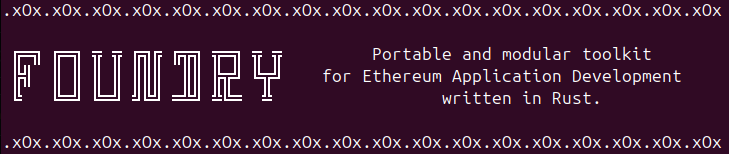
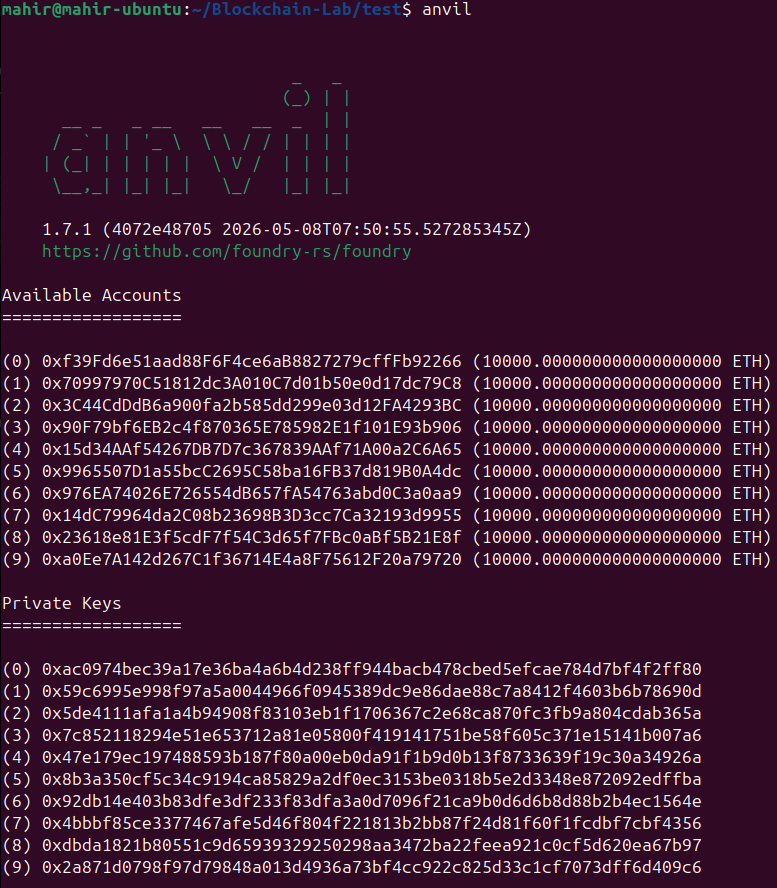
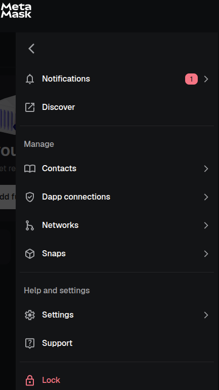
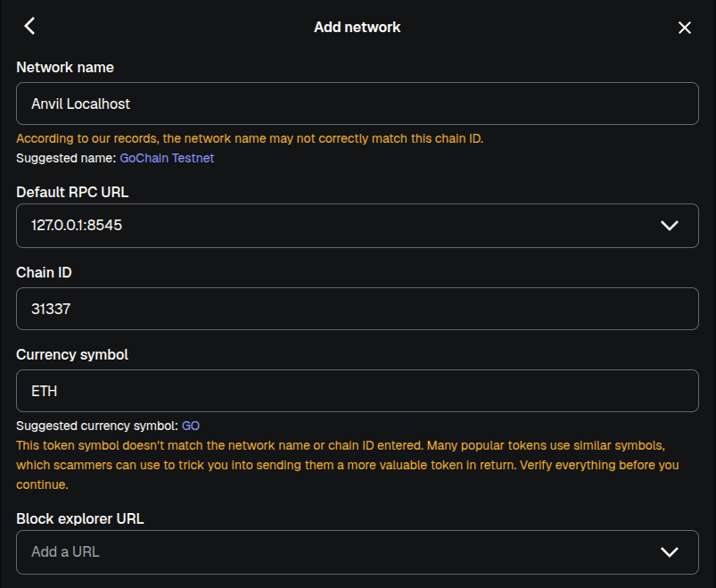
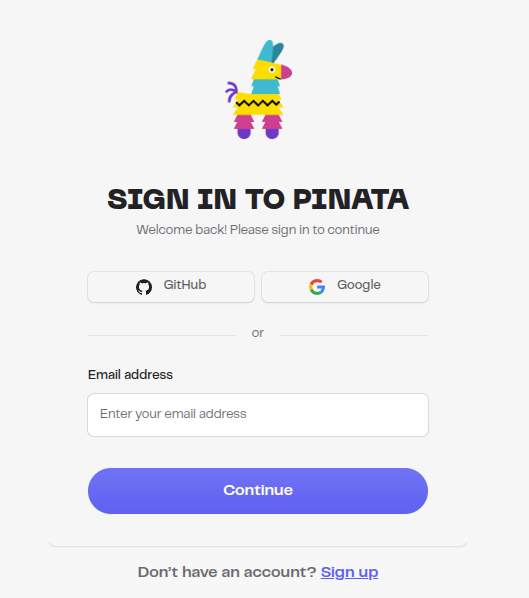
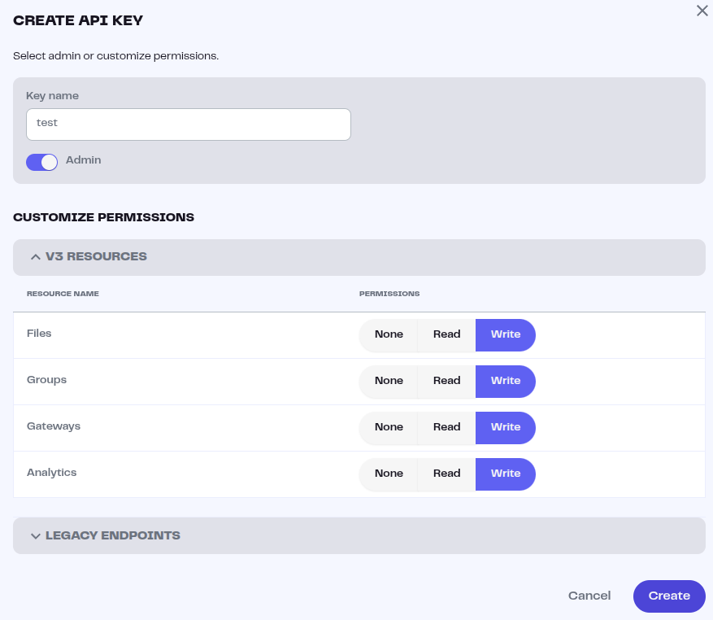
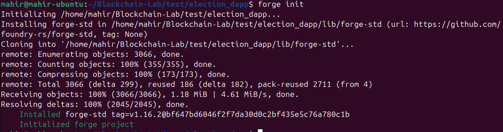
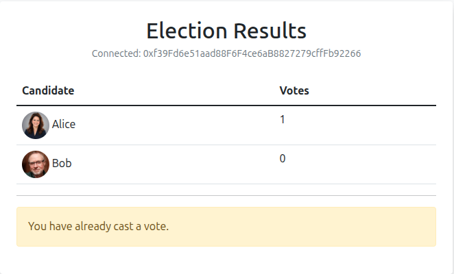

# Lab 5: Building a Web3 Voting DApp with Ethereum, Foundry, and IPFS

## Objectives:
- To create a modern Ethereum decentralized web application using Foundry (Anvil & Forge) and Ethers.js.
- To decentralize heavy file storage (images) utilizing the IPFS network via Pinata.
- To utilize MetaMask to offload account management and securely sign transactions.
- To understand the difference between manual state fetching and blockchain event-driven auto-syncing.

## Submission: 
- Five checkpoints.

## Description:
In this lab, you will learn how to deploy a smart contract using the modern development environment Foundry. You will use Anvil, an in-memory local blockchain node, and Forge, a fast compiler and deployment tool. Unlike previous labs where all data was stored on-chain, you will integrate Pinata to store Candidate images on the InterPlanetary File System (IPFS) to save massive amounts of gas fees. Finally, you will build a Vanilla JavaScript frontend to interact with this architecture.

---

# Section-1: Development Environment Setup
The first step is to set up our modern Web3 tools and local blockchain.

1. First, we need to ensure you have Node.js installed. We will use Node Version Manager (NVM). Open your terminal and run:
```shell
nvm install 22.23
nvm alias default 22.23
node -v
```
You should see ```v22.23.x``` confirming the installation.

2. Next, we will install Foundry. Issue this command in your terminal:
```shell
curl -L https://foundry.paradigm.xyz | bash
```


The terminal should show foundryup path detected since we installed it last lab if not, please follow the last lab's procedure.
Close and reopen your terminal, then run:
```shell
foundryup
```


Like before our Foundry toolkit will show an output like this to confirm our installation was correct. 
3. Start your local blockchain node by simply typing:
```shell
anvil
```


Note: Leave this terminal window open and running for the entire lab. You will see a list of 10 Accounts and their Private Keys. Each is pre-funded with 10,000 fake ETH.

### Now we will run our MetaMask wallet, add our local network to it and import some wallets from the local chain.

1. If MetaMask is already available on your browser, skip this step. Else, go to https://metamask.io/ and install the extension.
2. We need to connect MetaMask to our running Anvil node. Open MetaMask, click the three dots or, sandwich icon and click the Networks option here.



3. From here click the bottom `Add a custom network option` and add our Custom network details like the bottom Screenshot with the following information:



- Network Name: ```Anvil Localhost```

- New RPC URL: ```http://127.0.0.1:8545```

- Chain ID: ```31337```

- Currency Symbol: ```ETH```

Note: Do not pay heed to the yellow warnings and save it.

4. Our Local Anvil network won't be chosen by default so, click the Network: Option that is seen below the Tokens option and choose our Custom Network which should be ```Anvil Localhost```

.

5. Go to your Anvil terminal, copy the Private Key for ```Account (0)```. In MetaMask, click your Account option (above) -> Add wallet (below) -> Import Account (Via a private key) -> paste the private key. You should now see an account with 10,000 ETH!


Note: Renaming this account as ```Anvil Admin``` is better for understanding. As this account will deploy all of our contracts by default due to being the 0 number wallet and also we will use its functionalities for our privileged features so it is better to rename it like this. Even if you delete this network the wallet address will remain the same for the local Anvil node.

### We need a decentralized storage anchor now. 

Go to [Pinata.cloud ](https://pinata.cloud/)and create a free account. 



It is easier to just click sign in with google since we will just be using it's API functionalities.

Navigate to API Keys (Left Below Developer) -> +New Key (Top Right). Give it a name and for now Grant Admin permissions, generate the key, and copy the JWT (JSON Web Token). Save this somewhere safe.



# Checkpoint – 1: 
Show your teacher your Anvil terminal running, your MetaMask connected to the ```31337``` network with ```10,000 ETH```, and your Pinata ```JWT``` copied.

# Section-2: Smart Contract Development
Now we will write and deploy our backend logic using Forge.
1. Open a new terminal window (do not close Anvil) and create your project directory:
```shell
mkdir election_dapp
cd election_dapp
forge init
```


This should initialize a standard layout and environment for our Foundry project.

2. Delete the default files inside the ```src/``` directory. Create a new file named ```Voting.sol```:
```shell
touch src/Voting.sol
```
3. Open ```src/Voting.sol``` and paste the following code. Notice we have intentionally left placeholders (```TODO_SC-1``` and ```TODO_SC-2```) where we will add Events later.
```solidity
// SPDX-License-Identifier: MIT
pragma solidity ^0.8.20;

contract Voting {
    struct Candidate {
        uint256 id;
        string name;
        uint256 voteCount;
        string ipfsImageHash;
    }

    mapping(uint256 => Candidate) public candidates;
    mapping(address => uint256) public hasVoted; 

    uint256 public candidatesCount;
    uint256 public totalVotes; 
    uint256 public electionId; 
    address public admin;

    uint256 public constant MAX_VOTES = 3; 

    // TODO_SC-1: YOU WILL DECLARE BLOCKCHAIN EVENTS HERE LATER

    error AlreadyVoted();
    error InvalidCandidate();
    error ElectionEnded(); 
    error AdminCannotVote();

    constructor() {
        admin = msg.sender;
        electionId = 1; 
    }

    function addCandidate(string calldata _name, string calldata _ipfsImageHash) public {
        require(msg.sender == admin, "Only admin can add candidates");
        candidatesCount++;
        candidates[candidatesCount] = Candidate(candidatesCount, _name, 0, _ipfsImageHash);
        
        // TODO_SC-2: YOU WILL EMIT AN EVENT HERE LATER
    }

    function vote(uint256 _candidateId) public {
        if (msg.sender == admin) revert AdminCannotVote();
        if (totalVotes >= MAX_VOTES) revert ElectionEnded();
        if (hasVoted[msg.sender] == electionId) revert AlreadyVoted();
        if (_candidateId == 0 || _candidateId > candidatesCount) revert InvalidCandidate();

        hasVoted[msg.sender] = electionId; 
        candidates[_candidateId].voteCount++;
        totalVotes++; 

        // TODO_SC-3: YOU WILL EMIT AN EVENT HERE LATER
    }
    
    // TODO_SC-4: YOU WILL ADD THE RESET ELECTION FUNCTION HERE LATER
}
```
4. Deploy the contract to your Anvil node using your first account's private key. Run this command:
```shell
forge create src/Voting.sol:Voting --rpc-url http://127.0.0.1:8545 --private-key 0xac0974bec39a17e36ba4a6b4d238ff944bacb478cbed5efcae784d7bf4f2ff80 --broadcast
```
CRITICAL: In the terminal output, find ```Deployed to: 0x...``` and copy that address. You will need it for your frontend and it could update after every change and consequent forge create.

# Checkpoint – 2: 
Show your teacher the successful deployment output and the ```Deployed to``` address.

# Section-3: DApp Skeleton & IPFS Setup
We will now build the frontend to interact with our contract and Pinata.
1. Inside your ```election_dapp``` folder, create a new directory called ```frontend``` and navigate into it. Create three files:
```shell
mkdir frontend
cd frontend
touch index.html ipfsHelper.js app.js
```
2. Open ```index.html``` and paste this skeleton. It utilizes Bootstrap for quick styling and includes forms for our admin panel and voting logic.

```html
<!DOCTYPE html>
<html lang="en">
<head>
    <meta charset="UTF-8">
    <meta name="viewport" content="width=device-width, initial-scale=1.0">
    <title>Web3 Voting DApp</title>
    <!-- Corrected Bootstrap URL -->
    <link href="https://cdn.jsdelivr.net/npm/bootstrap@5.1.3/dist/css/bootstrap.min.css" rel="stylesheet">
</head>
<body class="bg-light">

<div class="container mt-5">
    <div class="row justify-content-center">
        <div class="col-md-6 bg-white p-4 rounded shadow">
            
            <h2 class="text-center mb-1">Election Results</h2>
            <p id="accountAddress" class="text-center text-muted small mb-4">Connecting...</p>

            <!-- Winner View -->
            <div id="winnerBanner" style="display:none;" class="text-center">
                <h2 class="text-success mb-3">🎉 Election Ended! 🎉</h2>
                <ul id="winnerStats" class="list-group list-group-flush mt-3"></ul>
            </div>

            <!-- Voting View -->
            <div id="votingArea">
                <table class="table table-hover">
                    <thead><tr><th>Candidate</th><th>Votes</th></tr></thead>
                    <tbody id="candidatesResults"></tbody>
                </table>
                <hr>
                <form id="votingForm" onsubmit="event.preventDefault(); App.castVote();">
                    <select class="form-select mb-2" id="candidatesSelect"></select>
                    <button id="voteBtn" class="btn btn-primary w-100">Cast Vote</button>
                </form>
                <p id="alreadyVotedMsg" class="alert alert-warning mt-2" style="display:none;"></p>
            </div>

            <!-- Admin Area -->
            <div id="adminArea" class="mt-4 p-3 border rounded bg-light" style="display:none;">
                <h5 class="mb-3">Admin Controls</h5>
                <input id="candidateName" class="form-control mb-2" placeholder="Candidate Name">
                <input type="file" id="candidateImage" class="form-control mb-2">
                <button onclick="App.addCandidate()" id="addBtn" class="btn btn-dark w-100">Add Candidate</button>
                <button onclick="App.resetElection()" class="btn btn-danger w-100 mt-2">Reset Election</button>
            </div>
        </div>
    </div>
</div>

<!-- JS URLs -->
<script src="https://code.jquery.com/jquery-3.6.0.min.js"></script>
<script src="https://cdnjs.cloudflare.com/ajax/libs/ethers/6.7.0/ethers.umd.min.js"></script>
<script src="ipfsHelper.js"></script>
<script src="app.js"></script>
</body>
</html>
```
3. Open ```ipfsHelper.js```. We will use this to bypass the blockchain entirely when uploading images, sending them straight to Pinata's servers. 

Paste your Pinata JWT here, replacing the JWT placeholder here.
```javascript
// ipfsHelper.js
window.uploadToIPFS = async (file) =>{
    // TODO_JS-1: PASTE YOUR PINATA JWT HERE
    const PINATA_JWT = "YOUR_JWT_TOKEN_HERE"; 

    const formData = new FormData();
    formData.append("file", file);

    try {
        const response = await fetch("https://api.pinata.cloud/pinning/pinFileToIPFS", {
            method: "POST",
            headers: { Authorization: `Bearer ${PINATA_JWT}` },
            body: formData,
        });
        const data = await response.json();
        return data.IpfsHash; // We return the IPFS Hash (CID)
    } catch (error) { console.error("IPFS Error:", error); }
};
```
4. Finally, open ```app.js```. This is where Ethers.js bridges our frontend to Anvil. Paste this base code and make sure to update the ```CONTRACT_ADDRESS```. 
### Core Concept: Providers vs. Signers
```Provider```: ```ethers.BrowserProvider``` is a read-only gateway to the blockchain (via MetaMask). It lets you call view functions (like checking votes or candidate lists) for free because reading doesn't change state.

```Signer```: The Signer represents the user's private key. Any function that changes state (like ```addCandidate``` or ```vote```) requires a transaction to be signed and broadcasted, which costs gas and prompts MetaMask to pop up.

```javascript
// Update with your Deployed To address from Checkpoint 2
const CONTRACT_ADDRESS = "0xYOUR_ADDRESS_HERE"; 

const CONTRACT_ABI = [
    "function admin() view returns (address)",
    "function candidatesCount() view returns (uint256)",
    "function totalVotes() view returns (uint256)",
    "function MAX_VOTES() view returns (uint256)",
    "function electionId() view returns (uint256)", 
    "function candidates(uint256) view returns (uint256 id, string name, uint256 voteCount, string ipfsImageHash)",
    "function hasVoted(address) view returns (uint256)", 
    "function addCandidate(string _name, string _ipfsImageHash)",
    "function vote(uint256 _candidateId)",
    "function resetElection()",
    "event CandidateAdded(uint256 id, string name, string ipfsImageHash)",
    "event VotedEvent(uint256 indexed candidateId, address voter)",
    "event ElectionReset(uint256 newElectionId)"
];

const App = {
    provider: null, signer: null, contract: null, account: null, isRendering: false,

    init: async function() {
        if (typeof window.ethereum === 'undefined') await new Promise(r => setTimeout(r, 1000));
        if (window.ethereum) {
            try {
                this.provider = new ethers.BrowserProvider(window.ethereum);
                await this.provider.send("eth_requestAccounts", []);
                this.signer = await this.provider.getSigner();
                this.account = await this.signer.getAddress();
                this.contract = new ethers.Contract(CONTRACT_ADDRESS, CONTRACT_ABI, this.signer);
                
                $("#accountAddress").text("Connected: " + this.account);
                
                window.ethereum.on('accountsChanged', async (accounts) => {
                    this.account = accounts[0];
                    this.signer = await this.provider.getSigner();
                    this.contract = new ethers.Contract(CONTRACT_ADDRESS, CONTRACT_ABI, this.signer);
                    this.render();
                });

                // TODO_JS-5: WE WILL ADD listenForEvents() FUNCTION CALL HERE LATER

                await this.render();
            } catch (err) { alert("Failed to connect: " + err.message); }
        } else { alert("MetaMask not installed!"); }
    },

    render: async function() {
        if (this.isRendering) return;
        this.isRendering = true;
        try {
            const count = await this.contract.candidatesCount();
            const adminAddress = await this.contract.admin();
            const totalVotes = await this.contract.totalVotes();
            const maxVotes = await this.contract.MAX_VOTES();
            const currentElectionId = await this.contract.electionId(); 
            const isAdmin = this.account.toLowerCase() === adminAddress.toLowerCase();

            $("#adminArea").toggle(isAdmin);

            let tableHtml = "", selectHtml = "", statsHtml = "";
            for (let i = 1; i <= count; i++) {
                const c = await this.contract.candidates(i);
                tableHtml += `<tr><td> ${c[1]}</td><td>${c[2]}</td></tr>`;
                statsHtml += `<li class="list-group-item d-flex align-items-center justify-content-between">
                                <div> ${c[1]}</div>
                                <b>${c[2]} votes</b>
                            </li>`;
                selectHtml += `<option value="${c[0]}">${c[1]}</option>`;
            }
            $("#candidatesResults").html(tableHtml);
            $("#candidatesSelect").html(selectHtml);
            $("#winnerStats").html(statsHtml);

            if (totalVotes >= maxVotes) {
                $("#votingArea").hide();
                $("#winnerBanner").show();
            } else {
                $("#votingArea").show();
                $("#winnerBanner").hide();
                const voteId = await this.contract.hasVoted(this.account);
                const hasVotedInCurrent = (voteId.toString() === currentElectionId.toString());
                
                if (isAdmin) {
                    $("#votingForm").hide();
                    $("#alreadyVotedMsg").text("Admin account cannot cast votes.").show();
                } else if (hasVotedInCurrent) {
                    $("#votingForm").hide();
                    $("#alreadyVotedMsg").text("You have already cast a vote.").show();
                } else {
                    $("#votingForm").show();
                    $("#alreadyVotedMsg").hide();
                }
            }
        } catch (err) { console.error(err); }
        this.isRendering = false;
    },

    // TODO_JS-2: STUDENTS WILL ADD addCandidate FUNCTION BELOW
    
    // TODO_JS-3: STUDENTS WILL ADD castVote FUNCTION BELOW

    // TODO_JS-4: STUDENTS WILL ADD listenForEvents FUNCTION BELOW

    // TODO_JS-6: STUDENTS WILL ADD resetElection FUNCTION BELOW
};

$(function() { App.init(); });
```
5. Open ```index.html``` using VS Code Live Server Extension (Install the extension shown in the screenshot below). 


- Click the ```Go Live``` button now which should appear from your ```index.html``` file at the bottom right. Your browser should ask for MetaMask permission and you have to accept them. 

# Checkpoint – 3:


Show your teacher the frontend correctly identifying your Admin account.

# Section-4: Adding Functionality & The Manual Sync Problem
Currently, our app connects to the blockchain, but we cannot add candidates or vote.
1. Open ```app.js```. Replace ```TODO_JS-2``` with the function to add candidates via IPFS.
```javascript
    addCandidate: async function() {
        const name = $("#candidateName").val();
        const file = document.getElementById("candidateImage").files[0];
        if(!file) return alert("Please select an image");
        
        $("#addBtn").text("Uploading...").prop("disabled", true);
        try {
            // First, bypass Ethereum and upload strictly to IPFS Pinata
            const hash = await window.uploadToIPFS(file);
            // Second, send the tiny returned Hash to our Smart Contract
            const tx = await this.contract.addCandidate(name, hash);
            await tx.wait(); // Wait for block confirmation
            $("#candidateName").val("");
        } catch(e) { console.error(e); }
        $("#addBtn").text("Add Candidate").prop("disabled", false);
    },
```
2. Replace ```TODO_JS-3``` with the function to cast a vote:
```javascript
    castVote: async function() {
        const id = $("#candidatesSelect").val();
        try {
            const tx = await this.contract.vote(id);
            await tx.wait();
            alert("Vote successful! Please refresh the page to see updated results.");
        } catch (error) { alert("Vote failed. Check console."); }
    },
```
3. Test the DApp:

- Ensure you are using your Admin account in MetaMask. Add a candidate (provide a name and an image file). Wait for the transaction to complete.


- You will see a confirmation option or, notification like this for every transaction and also see the fee needed. Your transaction should be different from this which we can discuss.

- Notice anything wrong? The table does not update! You must manually refresh the page to see the candidate appear.

- Like you imported the wallet of Admin account, import 3 more accounts via the Anvil Private keys and you could name them Anvil or, Account 1, 2, 3 for convinience.

- Switch to Normal user account in MetaMask. Cast a vote. Again, the vote count stays at ```0``` until you manually refresh the browser.



In a modern DApp, making users hit "Refresh" to see if a blockchain transaction went through is unacceptable. We need to utilize Solidity Events to auto-sync the UI.

# Checkpoint – 4: 
Show your teacher your DApp. Add a candidate and cast a vote, demonstrating that you have to manually refresh the browser to see the state changes.

# Section-5: Event-Driven Auto-Sync & Election Reset
Let's fix the manual reload issue by leveraging Ethereum's Event system.

By using ```this.contract.on()```, Ethers.js quietly listens to the Anvil blockchain in the background. The exact millisecond Anvil mines a block containing your event, Ethers.js intercepts it and automatically re-runs your ```render()``` function.

1. Open ```src/Voting.sol```. We need to emit signals into the blockchain whenever state changes.
At ```TODO_SC-1```, declare the events:
```solidity
    event CandidateAdded(uint256 id, string name, string ipfsImageHash);
    event VotedEvent(uint256 indexed candidateId, address voter);
    event ElectionReset(uint256 newElectionId);
```
At ```TODO_SC-2``` (inside ```addCandidate```), emit the event:
```solidity
emit CandidateAdded(candidatesCount, _name, _ipfsImageHash);
```
At ```TODO_SC-3``` (inside ```vote```), emit the event:
```solidity
emit VotedEvent(_candidateId, msg.sender);
```
2. While we are modifying the contract, let's add the ability to run multiple elections. At ```TODO_SC-4```, add this logic. Notice we do not delete old data; we simply increment ```electionId``` to start a fresh voting round which can only be done by the Admin.
```solidity
    function resetElection() public {
        require(msg.sender == admin, "Only admin can reset");
        for (uint256 i = 1; i <= candidatesCount; i++) {
            delete candidates[i];
        }
        candidatesCount = 0;
        totalVotes = 0;
        electionId++; 
        emit ElectionReset(electionId);
    }
```
3. Redeploy your Contract: Since we altered the Solidity code, we must recompile and migrate. Run the deployment command from Section 2 again.

CRITICAL: Copy the NEW ```Deployed to:``` address and update the ```CONTRACT_ADDRESS``` variable at the top of your ```app.js``` file!

4. Now let's teach Javascript to listen for these events. Open ```app.js``` and replace ```TODO_JS-4``` with this function:
```javascript
    listenForEvents: function() {
        this.contract.on("VotedEvent", () => this.render());
        this.contract.on("CandidateAdded", () => this.render());
        this.contract.on("ElectionReset", () => this.render());
    },
```
5. To initialize this listener, find ```TODO_JS-5``` inside the ```init``` function and add the function call:
```javascript
this.listenForEvents();
```
(Also, remove the ```alert``` instructing the user to refresh the page from your ```castVote``` function in ```app.js```, since it will now happen automatically!)

6. Finally, let's wire up the Admin reset button. Replace ```TODO_JS-6```:
```javascript
    resetElection: async function() {
        try {
            const tx = await this.contract.resetElection();
            await tx.wait();
            alert("Election reset successfully!");
        } catch (error) { alert("Reset failed: " + error.message); }
    }
```


# Checkpoint – 5: 
Open your DApp. Add a candidate. Notice the UI updates instantly without reloading! Cast 3 votes using different MetaMask accounts to trigger the "Election Ended!" banner. Finally, use the Admin account to Reset the election. Show your teacher the fully functioning, auto-syncing DApp to complete the lab.